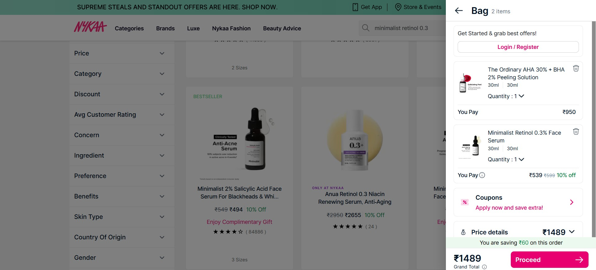
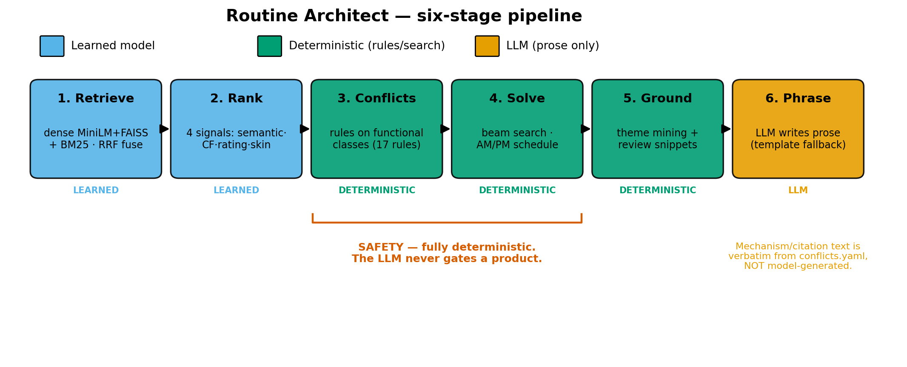
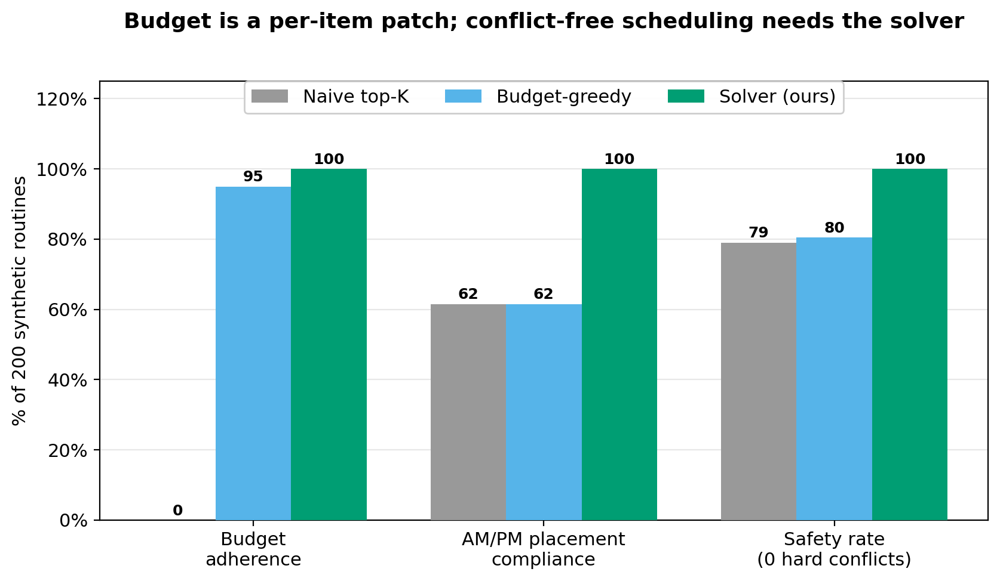
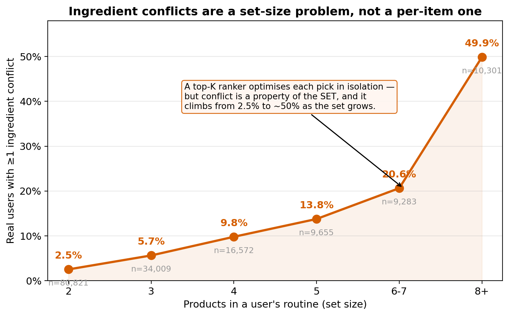
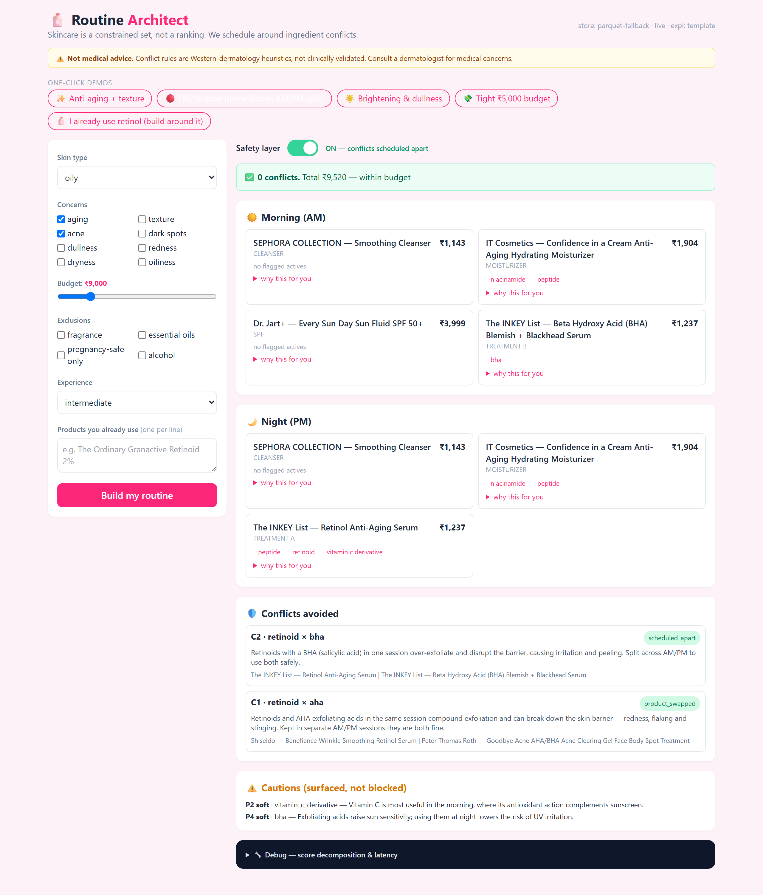
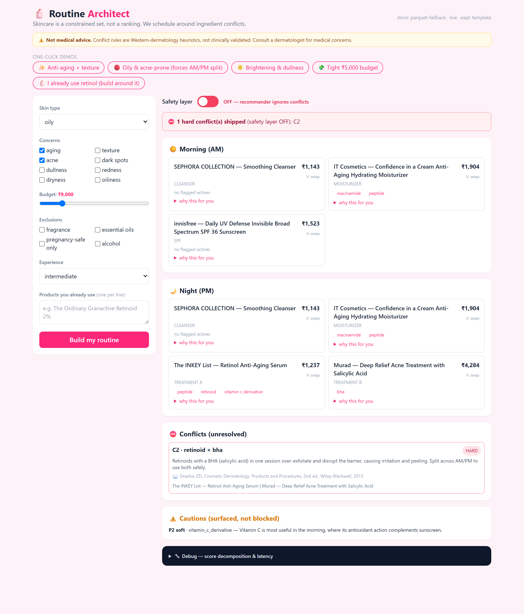
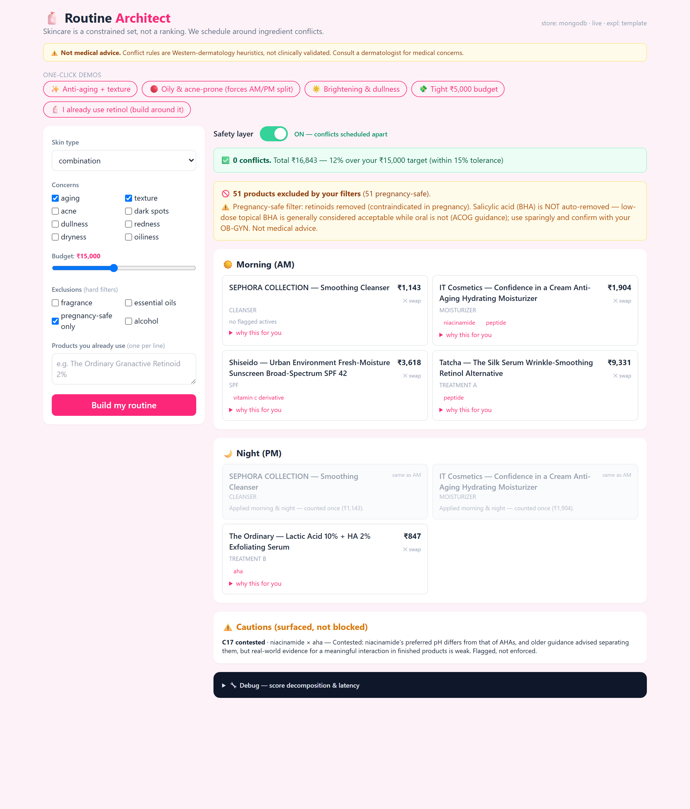

# Routine Architect
### Skincare recommendation as constrained set-selection, not ranking

*Technical assignment — orbo.ai GenAI Intern. Author's working prototype and evaluation.*
*Not medical advice. The conflict rules are 17 hand-curated dermatology heuristics, not a clinically validated safety system.*

---

## 1. Executive summary

Nobody buys one skincare product. They build a routine — a cleanser, a couple of treatments, a moisturiser, a sunscreen — and those products go on the same face within the same few minutes. Skincare actives interact chemically. Retinol and a glycolic acid in the same session irritate skin that either one alone would not. So the thing a person actually wants recommended is not an item. It is a *set* that has to hold together.

Every recommender I know of ranks items. It scores each product on its own and returns the top few. That is the right tool for "show me good vitamin C serums" and the wrong tool for "build me a routine", and the reason is structural, not a matter of tuning: a ranker scores products independently, so it has nowhere to put a constraint that only exists when you look at the whole basket. Budget is such a constraint. Chemical compatibility is such a constraint. Whether the retinol goes in the morning or the evening is such a constraint. A ranker cannot express any of them.

I built the ranker anyway — a proper hybrid one — and then put a constraint solver on top of it that treats the routine as a set. The division of labour is the whole design: **the learned models decide what is good for you; deterministic rules and a search decide what is safe together.** The safety layer never runs a language model. Every chemistry claim a user sees is copied verbatim from a cited rule file.

Three numbers say why this matters, and each is traceable to the evaluation in §7:

- A conventional recommender, personalising to a user's two concerns, spends a **median 2.36× the budget it was given** — zero budget compliance across 200 test profiles. The solver stays inside budget 100% of the time. This number needs no assumption about how we detect ingredients; it is just arithmetic on price.
- The same conventional recommender ships a **hard ingredient conflict in 21%** of those routines. The solver ships zero, by construction — it schedules the conflicting products into different sessions instead of removing them.
- It does this in **roughly 50 milliseconds** per request.

There is a quieter finding underneath, and it is the one I would repeat in a meeting. A generic bestseller list is chemically safe — but only because it recommends nothing in particular. The conflicts appear the moment the system starts personalising, which is the moment it starts doing its job. A better recommender makes this *worse*, not better, until something reasons about the basket. That is the gap this fills.

Commercially, a routine that irritates skin is three problems at once: a return, a one-star review, and a support ticket. It is also a trust problem, which is the expensive one. orbo already reads a customer's skin. The natural next step is to recommend a routine that customer can actually use — and to do it without printing a confident chemistry claim that turns out to be wrong. That last part is a design choice this prototype makes deliberately and repeatedly, and it is the part I would want a dermatologist to check before anyone shipped it.

---

## 2. The problem: a routine is a set, and a set has properties an item does not

Here is the thing I noticed, and everything else in this document follows from it.

Ask a recommender for a skincare routine and it will rank products for each slot and hand you the winners. A great cleanser. A great treatment. Another great treatment. A great moisturiser. Each one is genuinely a good pick. Put them on your face and two of them fight.

This is not a bug in the ranking. The ranking did exactly what ranking does — it found the best item for each slot, independently, which is the only thing the abstraction can do. The problem is that "these five products irritate skin when used together" is not a fact about any one of the five. It is a fact about the *set*. And a function that scores items one at a time has no place to hold a fact about the set. You can tune it forever and it will never learn to avoid the pairing, because it never sees the pair.

Three different constraints live at the level of the set, and a ranker violates all three for the same reason:

**Budget.** A user says ₹12,000. Each product, ranked on its own merits, looks affordable. Five of them together cost ₹28,000. The ranker never added them up because addition is a property of the basket, not the item. In testing, a naive recommender spent a median of 2.36× the budget it was handed (§7).

**Chemical compatibility.** Retinol and glycolic acid are both excellent. Together in one session they over-exfoliate. The ranker recommends both because each is individually strong; the interaction is invisible to it.

**Time-of-day placement.** Retinol degrades in sunlight and belongs in the evening. Vitamin C pairs well with daytime sun protection. "Which session" is a decision about how the set is arranged across the day — again, not a property any single item carries.

Now the reframe. If conflicts were a property of the *routine*, the only way to resolve them would be to drop one of the two products. But they are not. They are a property of the **session**. Retinol and a BHA acid conflict when they touch skin in the same sitting. Split them — acid in the morning, retinol at night — and both are fine. So the system does not have to choose between two good products and throw one away. It **schedules around** the conflict. This is the difference between an expert system that says "no" and a recommender that says "yes, and here is how to arrange it." It keeps more of what the user wanted.

There is a second corollary, and I only saw it once I looked at real purchase behaviour (§7). The safest possible recommendation is a list of generic bestsellers — a volume cleanser, a bland moisturiser, a popular sunscreen. It is safe because it is *unopinionated*. It targets no concern in particular, so it loads no actives, so nothing conflicts. The instant you personalise — the instant you say "this user has acne and early aging, give them a BHA and a retinoid" — you have created exactly the pairing that needs scheduling. **Conflict is manufactured by personalisation.** The better the recommender gets at matching actives to concerns, the more conflicts it creates, right up until something reasons about the basket. A ranker cannot be that something. That is the whole case for building the layer.

---

## 3. Why the platforms people actually use don't solve this

I wanted to check that this gap is real and not a strawman, so I went and built the failure on a live storefront.

As of 9 August 2026, logged out, I added two products to a Nykaa bag: **The Ordinary AHA 30% + BHA 2% Peeling Solution** (₹950) and **Minimalist Retinol 0.3% Face Serum** (₹539). That is a strong acid peel and a retinoid — the retinoid × AHA and retinoid × BHA pairings that my rule base flags as hard conflicts (C1, C2). The bag showed a grand total of ₹1,489, a savings banner, and a **Proceed** button. It said nothing about using the two together.



Then I read the peeling solution's own product page on Nykaa, because the interesting question is not whether the warnings exist but what they are *about*. They exist, and they are thorough. The "How to use" section says, verbatim, to use it "once or twice a week, ideally in the evening, on thoroughly clean, dry skin", not on wet skin, and to "leave on for no more than 10 minutes". It advises patch-testing before use, on unbroken skin. It carries a Sunburn Alert: the product "contains an alpha hydroxy acid (AHA) and a beta hydroxy acid (BHA) that may increase your skin's sensitivity to the sun", so "use a sunscreen, wear protective clothing, and limit sun exposure while using this product and for a week afterwards". The Ordinary is careful, and Nykaa displays all of it.

Not one sentence of any of it is about what else is in your routine. Every caution is scoped to *this product* and *your skin* — never to this product and another product. Even scrupulous labelling has no vocabulary for interactions, because the whole ecosystem it lives in — the label copy, the catalogue schema, the ranking pipeline — is organised around individual items.

Two lines make that concrete. The first is a warning the page does carry: "do not use on sensitive, peeling, or compromised skin." Retinol *causes* peeling. So the warning that would have caught this exact pairing is technically present on the page — but it is expressed as a *skin state*, not an *interaction*. And a skin state is a form nothing downstream can act on, because acting on it requires knowing what else the user is about to put on their face. The whole problem, in one line of label copy.

The second is that the ingredient list is right there too. Glycolic and salicylic acid are printed in this product's listing; retinol is printed in the other product's. That is the *same field my parser reads* to build function vectors — the signal that these two conflict is sitting in the catalogue, in plain text, on both pages. Nothing downstream ever looks at two products at once, so nothing uses it.

The Sunburn Alert is the tell. It states a real constraint — if you use this, wear sunscreen — and then hands responsibility for it to the user's memory. My solver treats the identical rule as structural: if a photosensitising active goes into a routine, sunscreen is not a reminder, it is a mandatory terminal step the routine cannot omit. Same fact, same source, one page apart. The only difference is whether anything downstream was built to act on it.

This is one product listing and one bag, logged out, on one day — not a claim about everything Nykaa does. But the shape generalises, because the organising principle does. Amazon, Sephora and the rest are built the same way: retrieval finds relevant items, a model ranks them, the cart totals a price. Every stage operates on items. There is no stage that operates on the basket as a chemical object, because selling was never modelled as basket construction. My argument is not that these are bad platforms. It is that they are ranking platforms, and routine safety is not a ranking problem.

---

## 4. Approach and architecture

The design is one sentence: **learned models decide what is good for you, deterministic rules and a search decide what is safe together, and the language model is allowed to write prose and nothing else.**

A request flows through six stages. The first two are learned. The next three are deterministic. The last touches an LLM, but only for phrasing.



**1 — Retrieve.** For each slot, find ~40 candidate products. Dense retrieval (a sentence-transformer embedding indexed in FAISS) and sparse retrieval (BM25) run in parallel and are fused. *Learned.*

**2 — Rank.** Score the candidates for this specific user by blending four signals: semantic similarity, collaborative filtering over co-reviewed products, a rating prior, and skin-type affinity. *Learned.*

**3 — Check conflicts.** Map each product to functional ingredient classes (retinoid, AHA, BHA, vitamin C, and so on) and look up which pairs conflict in a cited rule file. *Deterministic.*

**4 — Solve.** Search over which product fills each slot and which session (AM/PM) it occupies, maximising preference subject to the hard constraints: no conflict within a session, stay within budget, respect placement rules, include sunscreen if a photosensitiser is present. *Deterministic.*

**5 — Ground.** Pull the review themes and matched-skin review snippets that will justify each pick. *Deterministic.*

**6 — Phrase.** Optionally, have an LLM turn that grounding into one friendly sentence per product. If the LLM is unavailable or its quota is exhausted, a template writes the sentence instead. *LLM, or a deterministic fallback.*

The important line in that diagram is the red bracket under stages 3 and 4. **Safety is fully deterministic. The language model never decides whether a product is safe, never generates a chemistry claim, and never gates a recommendation.** When the interface tells a user "we moved your BHA to the morning because retinoids and BHAs over-exfoliate together", every content word of that — the mechanism, the citation — is copied verbatim from the rule file. The LLM's entire job is to make "reviewers with your skin type liked this" read like a human wrote it. If it dies, the product still works; it just reads a little more like a form.

There is a test that has to pass for this division of labour to be honest, and I ran it (§7). Turn the whole conflict-and-solver layer off. If the recommendations fall apart, then the rules were secretly doing the recommending and I built an expert system wearing a recommender's coat. They do not fall apart — preference quality is unchanged with the layer off; the only thing that changes is that conflicts come back. The ranker makes the recommendations good. The layer only makes them safe.

---

## 5. How the recommendation is actually made

This section walks the pipeline in more depth. It is still meant to be readable without the code; the genuinely technical detail is in Appendix A.

**Retrieval.** Each product gets a short text — name, brand, its functional classes written as ordinary words, category, highlights, top ingredients — embedded with `all-MiniLM-L6-v2` into a 384-dimensional vector, indexed in FAISS. The same text feeds a BM25 index, into which I also inject the functional-class keys as literal tokens, so a lexical search for "retinoid" hits the function directly instead of matching the substring "acid" in every acid. Dense and sparse results are combined with Reciprocal Rank Fusion at k = 60 — the standard value; I had no validation budget to tune it and 60 is the widely used robust choice. Fusion earns its place: a retinol serum ranked 28th by embedding and 5th by BM25 surfaces at 6th once fused.

**Ranking.** Four signals, blended with fixed weights. Semantic similarity to the concern query. Collaborative filtering from a co-review matrix. A Bayesian rating prior that shrinks a product's average rating toward the global mean by its review count, so two five-star reviews don't outrank a well-loved product with a thousand. And a skin-type affinity, itself shrunk toward the product's overall positive rate so a lucky handful of reviews from one skin type can't dominate. The deployed weights are semantic 0.3, CF 0.5, rating 0.1, skin 0.1 — a choice I'll defend with numbers in §7, because the honest version of that story reversed itself halfway through.

**Conflict checking.** The rule base is 17 rules, each carrying four fields: the pair of classes, a severity, a plain-language mechanism, and a citation. Ten are hard (blocked), five are soft (allowed with a caution), two are contested. The mechanism string is what the user reads, rendered verbatim; the LLM is never in this path. Rules operate on functional classes, never raw ingredient strings, and same-class rules like retinoid × retinoid require two *distinct* products — one product that happens to formulate two forms of an active is not a routine conflict. The full rule base with citations is Appendix C.

Two of the rules are contested — vitamin C × niacinamide and niacinamide × AHA — and I kept them *because* they are contested. The vitamin-C-and-niacinamide claim traces to 1960s lab work done under heat and is largely dismissed by formulation chemists for finished products. Most apps either apply the folk rule silently or ignore it silently. This one surfaces the disagreement, shows where the claim comes from, and declines to decide for the user. That is a small thing that signals a larger one: the rules were read from primary sources, not scraped from blog posts.

**The solver.** A beam search over five slots — cleanser, two treatments, moisturiser, sunscreen — each placed into a session. It maximises summed preference plus concern coverage, minus function redundancy and any budget overrun, subject to the hard constraints. The search space is tiny (five slots, twenty candidates each), so it runs in milliseconds. It fills the base slots first, so an expensive serum can't starve the mandatory sunscreen of budget. And it reports, for every conflict a naive recommender would have shipped, what it did instead: *scheduled apart* (both kept, split across AM/PM), *product swapped* (a different pick for one concern removed the conflict), or *excluded, no alternative*. "We avoided a conflict" is a claim. "We moved your BHA to the morning" is checkable against the board.

**Grounding and explanation.** Rather than assert "reviewers liked this", the system mines each product's reviews for recurring themes and pulls the actual snippets written by reviewers with the user's skin type, preferring non-sponsored ones. That grounding is shown in the interface. The LLM, when enabled, is handed *only* that grounding and told to write one sentence from it and invent nothing. How well it obeys that instruction is measured, honestly, in §7.

---

## 6. Dataset and assumptions

The whole thesis depends on being able to read ingredient lists, so before writing anything I checked that the data would support it. The dataset is the Kaggle *Sephora Products and Skincare Reviews* set: **8,494 products** and, across its five review shards, **1,094,411 reviews from 503,216 unique authors**.

Ingredient coverage cleared the bar comfortably. 88.9% of products have a non-null ingredient field; 97.0% of those parse cleanly; so **86.2% of the whole catalogue** parses to at least five recognised ingredient tokens. Within the four routine slots — the products that can actually be recommended — coverage is higher still, **94.8%** with a non-empty function vector (cleanser 94.2%, treatment 93.6%, moisturiser 96.3%, sunscreen 97.2%). I report 86.2%, not the 88.9% non-null rate, because the non-null rate counts empty and junk strings as "covered" and overstates what the engine can reason about.

A few assumptions and limits are worth stating plainly, because they bound what the numbers mean.

**INCI ordering gives rank, not percentage.** Ingredient lists are legally ordered by descending concentration above 1%, so a product's position in the list is a free potency proxy — I weight earlier ingredients more (`1/log₂(position+2)`). But below 1%, ordering is unconstrained, so this cannot tell 0.5% retinol from 2% retinol. That is a real limitation, not a detail. It also means the engine leans *inclusive* on the safety side: a retinoid listed deep in a list still counts as a retinoid, because a false alarm costs an unnecessary AM/PM split (harmless) while a miss ships an irritating routine (not harmless).

**Collaborative filtering is thin, so it can't be the backbone.** Only 8.1% of users have written five or more reviews; the median user has written one. So content and embedding signals have to carry the cold cases, and CF is one signal among several, never the spine. The leave-one-out evaluation is sized on the 40,880 users with five or more reviews.

**Concerns are synthetic.** The review schema has no "concern" field, so the 200 evaluation profiles pair a real skin-type distribution with concerns drawn from a stated prior. Skin type is real; the concern pairing is simulated. The conflict numbers are driven by real product ingredient data and hold across eight random seeds, but the profile generator is a model, and I say so wherever its output is quoted.

**Some rules rarely fire because the ingredients are rare here.** This is a US/Western catalogue. Benzoyl peroxide appears in 7 products, sulfur in 13, copper peptides in 24. Rules touching those will almost never fire — not because the engine is broken, but because the catalogue barely contains the ingredients. Worth stating so a low fire-rate isn't misread.

**Prices are converted at a fixed rate.** 1 USD = ₹95.21, fixed rather than live, so the demo is reproducible offline. It also means the catalogue is priced for the US premium market — a consequence I return to in §9.

---

## 7. Results

The standard retrieval metrics come first because the brief asks for them, and then I'll argue they are the wrong lens. The routine-level results are the point.

### 7.1 The three-way comparison — the core result

I built two baselines, not one, because a single number with nothing beside it means nothing. The first is a **naive top-K** recommender: the top-rated product per slot, both treatments defaulted to the morning, no awareness of anything. The second is a **budget-aware greedy** — what a competent engineer ships *without* a solver: split the budget across slots and take the best product that fits each share. The third is the **solver**. All three run on the same 200 profiles, the same candidate pools.

| Metric (200 profiles) | Naive top-K | Budget-greedy | **Solver** |
|---|---:|---:|---:|
| Budget adherence | 0% | 95% | **100%** |
| AM/PM placement compliance | 61.5% | 61.5% | **100%** |
| Safety rate (0 hard conflicts) | 79% | 80.5% | **100%** |
| Concern coverage | 100% | 100% | 97.5% |
| Function redundancy (lower better) | 0.300 | 0.135 | **0.085** |
| Preference relevance (Σ, higher better) | 3.653 | 1.539 | 2.460 |



Read the first three rows across and the argument is right there. **Budget is a per-item constraint, and a per-item heuristic fixes it** — the greedy's even split takes budget adherence from 0% to 95% without any search at all. **Placement and conflict-safety are joint constraints over the whole set** — whether the retinoid can go in a session depends on what else is in that session — and the greedy leaves them exactly where the naive baseline did, 61.5% and 80.5%. It cannot touch them, because it still picks one slot at a time. Only the beam search, which reasons over the arrangement of the whole basket, closes them to 100%. This is the cleanest statement I can make that the *search* is doing the work, not merely "being sensible".

Now the row people expect to trip me up: preference relevance. The solver's 2.460 is below the naive baseline's 3.653 — of course it is, the naive number is the unconstrained maximum and is unreachable inside a budget. The fair comparison is against the greedy, which is the best a budget-respecting method does without a solver. There, **the solver scores higher, 2.460 against 1.539.** Allocating the budget jointly — spend on the treatments that matter, save on the cleanser — beats splitting it evenly. So the solver satisfies *more* constraints and *also* scores higher preference. It is not trading quality for safety. It buys both.

### 7.2 The sanity test: is this a recommender or an expert system?

The failure mode I was most afraid of is building an expert system by accident — a pile of rules that only looks like a recommender. The test is simple: turn the constraint layer off and see if the recommendations are still good.

With the layer off, preference relevance is 2.4526; with it on, 2.4535 — unchanged. Concern coverage is 0.975 either way. The only thing that changes is that turning the layer off reintroduces **9 hard conflicts across the 80 routines** it was suppressing. That is the result I wanted: the ranker is what makes the recommendations good and personal; the conflict layer is a thin safety constraint sitting on top, not a substitute for one.

### 7.3 Conflict as a set-size problem — and a number that moved

The strongest evidence that this is real, not simulated, comes from what people actually bought. Among 165,565 users who co-reviewed two or more routine-slot products, I measured how often their own set contains a hard conflict, bucketed by how many products they own.



| Products in the set | 2 | 3 | 4 | 5 | 6–7 | 8+ |
|---|---:|---:|---:|---:|---:|---:|
| Users with ≥1 hard conflict | 2.5% | 5.7% | 9.8% | 13.8% | 20.6% | 49.9% |
| Users in bucket | 80,821 | 34,009 | 16,572 | 9,655 | 9,283 | 10,301 |

The rate climbs monotonically with basket size, from 2.5% to nearly 50%. This is the picture in one figure: **conflict is not a property of any product, it is a property of the set, and it grows as the set grows.** A top-K ranker optimises each pick in isolation and is blind to the whole curve.

The finding is not that personalisation moves users to the high end of this curve. It is that personalisation *lifts the curve*. At five products, real users conflict 13.8%; a naive recommender personalising to two concerns at the same basket size conflicts far more. It concentrates actives, delivering an eight-product level of risk in a five-product routine.

Here is a number that moved during the build, which I'm reporting because a number that survived scrutiny is more trustworthy than one that was never scrutinised. Early on, the naive recommender's synthetic hard-conflict rate was 47% (counting an active anywhere in the top 15 ingredients) or 70% (counting any position). Then I made the engine correct in a way that lowered my own headline: **cleansers are rinse-off.** A salicylic *cleanser* has seconds of contact and does not drive a leave-on conflict the way a salicylic *serum* does, so cleansers were changed to carry no conflict-relevant classes. That removed the cleanser-versus-treatment conflicts that had been padding the number, and the naive routine-level hard-conflict rate fell from 38.5% to **21%** (safety 61.5% → 79% in the table above). I could have kept the bigger number. The smaller one is more correct, so it is the one I report — and note that even the table's 21% is conservative, because the *engine* is more lenient about cleansers than the headline stat is.

The budget finding needs none of this. It doesn't depend on any ingredient-detection threshold at all. A naive recommender spends a median **2.36× the budget it was given**. That is just addition, and it is the most unarguable number in the document.

### 7.4 Standard retrieval metrics — reported in full, then set aside

The brief asks for these, so here they are, and they are weak. I'll explain why they're weak and why they're the wrong question.

Using a temporal split (train through June 2021, validate through April 2022, test on the disjoint period to March 2023) and the standard leave-one-out protocol — hold out each user's most recent 4★+ item, rank it against 100 sampled negatives:

| | NDCG@10 | Recall@10 | MAP@10 |
|---|---:|---:|---:|
| Random baseline | ~0.042 | — | — |
| Deployed blend, stale CF (test period) | 0.054 | 0.121 | 0.035 |
| Deployed blend, refreshed CF | **0.106** | — | — |

Cold-start users (one or two reviews) score NDCG@10 0.0497 against a random 0.045 — barely above chance. That is not hidden; it is the honest state of next-item prediction on a sparse, single-concern review signal, and it is exactly why the ranker keeps a rating prior and a skin affinity: for a cold user, CF and semantic similarity are both zero, and those two priors are the only lift there is.

But look at what these metrics are asking. "Given this user's history, did we rank their *exact* next purchase in the top ten, out of a hundred?" That is a good question for a store trying to predict a repeat buy. It is close to meaningless for "assemble a safe, coherent, budget-respecting routine", where there is no single correct next item and the thing that matters is whether the five products hold together. The standard metrics measure a target the system isn't aiming at. I report them because dropping them would be hiding a weakness; I lead with the routine-level metrics because they measure what the system is for.

One honest reversal is buried in that table, and it's worth surfacing. I expected collaborative filtering to be weak because the data is sparse. It was weak — but for a different reason than I thought. On the temporal test set CF looked like it simply didn't generalise. Then I refit it through the validation period so it was current at test time, and its NDCG roughly *doubled*, from 0.051 to 0.108. The weakness wasn't sparsity. It was **staleness**: let the co-review signal age eleven to twenty-one months and it decays to near-random; refresh it and it becomes the single strongest signal. That turned an apparent modelling limitation into an operational one — CF has to be refreshed on a cadence — which is a more useful thing to know, and it's why the deployed weights lean on CF (0.5) while keeping semantic (0.3) as the staleness-proof floor and rating+skin (0.1 each) as the cold-start lifeline.

### 7.5 Beyond-accuracy, latency, and explanation faithfulness

**Beyond-accuracy.** Per slot, the solver's recommendations cover 6.7–14.8% of the eligible catalogue, with intra-list diversity 0.15–0.38, novelty 3.8–7.0 bits, and a Gini popularity-bias coefficient from 0.24 (sunscreen, least biased) to 0.63 (moisturiser, most).

**Latency.** Retrieval runs at a p50 of 25 ms per slot, ranking and building all five slots at 4 ms, the basket solve at 22 ms — roughly **50 ms end to end**, well inside interactive budget. The one expensive stage is the optional LLM explanation, which adds about 1.3 seconds when enabled; that is precisely why the default fast path uses the template and the LLM is opt-in.

**Explanation faithfulness.** When the LLM writes the "why this for you" sentence, does every claim trace back to the grounding it was given, or does it embellish? I sampled 27 distinct products and judged each explanation with a *different* model family — Groq's `llama-3.3-70b-versatile` grading the Gemini generator, to avoid the self-preference bias of a model marking its own work.

| | Faithful | Rate |
|---|---:|---:|
| LLM (`gemini-flash-lite-latest`) | 24 / 27 | **88.9%** |
| Template (deterministic) | 26 / 27 | 96.3% |

The LLM buys readability at a real cost of roughly seven points of faithfulness, and I'd rather measure that than assume it. The three failures all have the same shape: the model adds a specific it wasn't given — an ingredient or product-type name, a vivid phrase ("feels like a glass of water"), or, in the worst case, a misattributed skin cohort ("reviewers with sensitive skin" for a combination user, leaked in through the raw review snippets rather than the mined themes). The template never does this, because it only ever restates the structured evidence — which is exactly why it is ~100% by construction.

I hand-checked five against the judge to make sure the judge itself was trustworthy, and it mostly is — but it errs strict, never lenient. One of its three "unfaithful" verdicts flagged the phrase "vitamin c serum" as unsupported when that is literally the product's own active and name; and its single template "miss" flagged our own "4★+" provenance annotation as an invented rating. So 88.9% is a conservative floor: the judge is more likely to punish a fair explanation than to pass a bad one.

---

## 8. Where it works, where it fails — and how I tested my own safety claims

The prototype ships with five one-click demos and a testing interface, because a safety claim you can't click is a slogan. All screenshots are in Appendix C.

**It works.** The flagship case is an oily, acne-prone, ageing profile — the interesting one, because it loads two conflicting actives. The routine pairs a retinoid and a salicylic-acid treatment, and the board shows the retinoid at night and the BHA in the morning, **scheduled apart**, with the verbatim mechanism ("both disrupt the skin barrier; layering them in one session causes irritation and peeling; split across AM/PM to use both safely") and its citation. Zero conflicts, sunscreen included, within a ₹14,000 budget.



Turn the safety layer off with the toggle and the same two actives collapse into the same session and the board goes red — the failure the layer prevents, shown live.



**It re-solves, which a ranked list cannot.** Reject a product with the swap button and the solver re-runs without it — and because the constraints are joint, removing one product can re-bind another slot. In the demo, rejecting the retinoid frees the BHA to move back to its preferred evening session, and the interface calls that out explicitly: "removing this re-bound the routine — also changed: treatment re-scheduled AM→PM." A list of ranked items has nowhere for that cascade to happen.

**It admits what it can't verify.** Tell it you already use a product it doesn't stock and it resolves the product through a five-tier ladder: fuzzy name match, semantic match, you paste the ingredient list, the LLM infers the likely actives, or you pick the classes by hand. The fourth tier — LLM-inferred ingredients — is the one that matters, because there the system **disables conflict checking and says so**: "we couldn't verify this product's ingredients, so conflict checking is unavailable for it — please check manually." It refuses to print a green checkmark on a chemistry claim it can't stand behind.

### 8.1 Testing my own safety claims

The most useful thing that happened to this build happened after I thought it was finished, and it belongs in the document rather than buried in a commit.

I ran an audit over my own code looking for over-engineering, and it surfaced something worse: the interface collected a **"pregnancy-safe" filter that the server accepted and never read**. Four exclusion checkboxes, all decorative. The dangerous one was pregnancy-safe — a user could tick it and receive a routine containing a retinoid, under a green "0 conflicts" banner. For a project whose entire argument is that safety constraints belong *in the architecture* rather than in reassuring copy, a silently-ignored safety input is the worst possible bug. "Feature-complete" had meant "every control is present", not "every control is wired", and I hadn't noticed the difference.

Fixing it, I made myself look for the same class of gap a second time, on the principle that "present but not wired" is a failure mode worth checking twice. It was there again, one layer down: the Redis **cache key omitted the exclusions**. So even after wiring the filter into the request path, a pregnancy-safe request could have been served a *cached* unfiltered routine from an earlier call — the same gap, re-opened by caching. A filter that is correct in the request path but absent from the cache key is still a broken filter. Both are fixed, and the safety path now has 19 tests behind it, including the case that a pregnancy-safe request removes retinoids and the case that it *doesn't* remove the things it shouldn't.

Two smaller judgement calls in that fix are worth a line, because they're the same pattern as the contested conflict rules — flag, don't overreach. First, the alcohol filter excludes *drying* alcohols (denatured, SD, ethanol, isopropyl) but spares *fatty* alcohols like cetearyl and cetyl, which are emollients, and benzyl alcohol, which is a preservative. A blunt substring search for "alcohol" would wrongly strip good products; getting that distinction right is the difference between a filter and a sledgehammer. Second, on pregnancy the filter removes retinoids outright but does *not* auto-remove salicylic acid — the guidance on low-dose topical BHA is weaker (topical is generally considered acceptable, oral is not), so it surfaces an ACOG-referenced caution and lets the user and their doctor decide, rather than pretending to certainty it doesn't have.

With the pregnancy filter on, that ageing profile now excludes 51 products, drops every retinoid, and covers the ageing concern with a retinol *alternative* — a peptide serum — plus an AHA, at zero conflicts. That is the screenshot I'd point a skeptic at.



---

## 9. Known limitations

The honest set. One line each, and one on what would close it.

**Cold-start accuracy is barely above random** (NDCG@10 0.0497 vs 0.045). A user with one review gives CF and semantic signals nothing to work with; a short onboarding quiz or orbo's own skin analysis would supply the priors the review history can't.

**The rule base is not clinically validated.** It is 17 hand-curated dermatology heuristics with citations, not a medical device; a dermatologist would need to review and expand it before it guided anyone's real routine. This is why the not-medical-advice disclaimer is in the interface and here.

**Test profiles are synthetic.** Skin type is real; the concern pairing is drawn from a prior because the data has no concern field. Real concern labels — which orbo could capture — would replace the simulation.

**Concentration is invisible.** INCI ordering gives rank, not percentage, so the engine cannot distinguish 0.5% from 2% retinol. Only manufacturer concentration data would fix this, and it isn't in the dataset.

**The catalogue is a premium US one.** A five-product routine here runs ₹10,000–16,000; an equivalent built from Indian D2C brands (Minimalist, Deconstruct, The Derma Co) would be three to five times cheaper. The engine is catalogue-agnostic (§13), so pointing it at a local catalogue is a data task, not an engineering one — but a real Indian deployment needs that catalogue.

**Some rules almost never fire** because their ingredients are rare in this catalogue (benzoyl peroxide in 7 products, sulfur in 13). Not a bug, but it means the conflict engine is under-exercised on those pairs.

**The sunscreen pool is thin** — 105 eligible products — so sunscreen recommendations have the least diversity of any slot.

**The "sensitive skin" cohort can leak** into an LLM explanation through the raw review snippets, even though the mined themes filter it out. The snippet text isn't cohort-filtered the way the themes are; it should be.

**Pinned-slot concern re-targeting is incomplete.** When a user's owned product fills a treatment slot, the other treatment slot still targets the static concern mapping rather than re-targeting the concern the pin leaves uncovered. Minor, and flagged.

---

## 10. What this is worth to a business

Translate the safety numbers into the language a beauty retailer actually uses.

A routine that irritates skin is not one problem. It is a **return**, because the customer blames the product. It is a **one-star review**, because they blame it publicly, and that review depresses the conversion of every future shopper who reads it. It is a **support ticket**, because they write in first. And underneath all three is a **trust** cost, which is the one that compounds: a customer burned by a recommendation stops trusting recommendations, and a store whose recommendations aren't trusted has lost the cheapest lever it has for average order value.

The commercial shape of the fix is favourable. The system recommends *routines*, not items, which raises basket size by construction — it is proposing four or five coherent products, not one. It does so without raising the return risk that normally comes with pushing more product, because the basket is checked for compatibility before it's shown. And the routine framing is a natural, non-pushy path to a larger order: "here is a routine that works together" is an easier sell than "customers also bought". Better basket size, lower return rate, and a trust story, from the same mechanism.

The precise numbers here — how much return rate actually moves, what a one-star review costs in downstream conversion — are orbo's to supply, and I list them in §14 as things I'd want before building this for real. The direction is not in doubt. The magnitude is theirs to measure.

---

## 11. Benchmark against Nykaa and Sephora

Since the brief asks for a comparison, here is an honest one — what the big platforms do better, where they're structurally blind, and where this prototype would have to grow to compete.

**What they do far better than this.** Catalogue breadth, in the tens of thousands of live SKUs with real-time price and stock. Genuine collaborative filtering over millions of logged-in purchase histories, not a sparse review proxy. Merchandising, logistics, returns, trust infrastructure — the entire machine of a real store. On raw item recommendation, they win comfortably, and nothing here competes on that ground.

**Where they are structurally blind.** All of them treat the cart as a price total, not a chemical object. §3 is the evidence for this: even a scrupulous product page warns only about the item and the skin, never about the *pair*, because there is no stage in a ranking-and-checkout pipeline that reasons about two products at once. This is not a tuning gap they could close by improving their ranker. It is the abstraction: rank items, sell items. Routine safety lives at the level of the set, and the set is exactly what item-ranking cannot see.

**Where this prototype could improve on them.** Its contribution is narrow and deep: the set-level constraint layer — per-session conflict scheduling, joint budget allocation, placement rules, and a grounded explanation that never fabricates chemistry. That layer is the thing the big platforms don't have and can't get from better ranking. The right way to read this project is not "a better Nykaa" but "the missing stage" — a routine-construction layer that could sit on top of any of their catalogues, because (§13) it depends only on ingredient lists, not on the catalogue it was built against.

---

## 12. Roadmap

Phased, and deliberately tied to what orbo already does.

**Phase 1 — harden what exists.** Replace synthetic concerns with real concern capture. Expand and get a dermatologist to validate the rule base. Add the CF refresh cadence that §7.4 showed is not optional. Load a real Indian D2C catalogue so the prices match the market. This is mostly data and validation work; the engine is built.

**Phase 2 — connect it to orbo's skin analysis.** This is the natural join, and it's why I chose this problem. orbo reads a customer's skin from an image — oiliness, texture, pigmentation, sensitivity. That output is *exactly* the profile this engine takes as input, except measured instead of self-reported. Skin analysis tells you what the skin needs; the routine architect turns that into a safe, budget-aware, buyable routine. One reads the problem, the other prescribes and checks the response. Phase 2 is wiring orbo's analyser output straight into the profile, so a scan becomes a routine without the customer typing anything.

**Phase 3 — close the loop.** Feed post-purchase outcomes — returns, re-orders, review sentiment, and eventually follow-up skin scans — back into the ranker and the rules. That turns a static rule base into one that learns which routines actually worked for which skin, which is the thing no static system, mine included, can currently know.

---

## 13. Closed-world versus open-world

Most recommenders quietly assume the catalogue is the universe: if a product isn't in the dataset, it doesn't exist. That assumption breaks the moment a real user says "I already use the Minimalist niacinamide" and it isn't in stock.

The reframe is that a product plays two different roles with two different requirements. As a **candidate to be recommended**, it must be in the catalogue — you can only sell what you stock, and that's correct. But as an **anchor** — "I already use X", "build around X", "find me a dupe for X" — it does not need to be purchasable at all. It only needs to be *reasoned about*. And the engine reasons over function vectors, not product IDs. Anything you can derive a function vector for, it can schedule around. The catalogue is just a convenient source of function vectors, not the boundary of what the system can think about.

That is what the five-tier resolution ladder (§8) implements, and it is why the architecture claim is more than a slogan: the solver, the rules and the ranker depend only on an abstract product interface — a function vector, a price, a category, a confidence label. Where the vector comes from — the catalogue, a pasted ingredient list, or an LLM's inference — is a data-layer detail. orbo could point this at its own catalogue on day one.

The ladder also forced me to measure the failure mode that actually matters, which is not "we couldn't find the product" but "we confidently found the *wrong* product", because a wrong match produces confident wrong safety advice. I took 30 product names deliberately not in the catalogue — including Indian D2C brands the US dataset doesn't carry — and measured how often fuzzy or semantic matching returned a confident wrong match. The first version was a disaster and taught me something about the matcher. `rapidfuzz`'s `WRatio` scorer gives roughly 85 to *any* product that shares a single word, because of its token-set component — so "Nivea Soft Cream" matched a random "Baomint Curl Cream" at 85.5. At the original cutoff of 84, **every one of the 30 off-catalogue names false-matched** — a 100% wrong-match rate, every one a confident wrong safety verdict waiting to happen. Switching the scorer to `token_sort_ratio`, which scores off-catalogue names 56–70 and genuine matches 81–97 — a clean, principled gap — and setting the cutoff to 80, dropped the false-match rate to **10%**. The three that remain are genuine semantic near-misses, the honest ceiling of automatic resolution, and for those the safe move is to fall through to "inferred, checking disabled" rather than assert.

---

## 14. What I'd want to know before building this for real

Knowing what you don't know is part of the work, so here is what I would ask orbo before treating any of this as production.

**Your return-rate data, broken down by whether the customer bought a single product or a multi-product routine.** The entire business case in §10 rests on the claim that incompatible routines drive returns. I believe it, but you can measure it and I can't. If routine returns aren't elevated, the priority order changes.

**A dermatologist, to own the rule base.** I curated 17 rules from primary sources, but I am not a clinician, and a safety layer that guides real skincare needs a real clinician's name on the rules — including the contested ones, where the right call is genuinely a judgement.

**Your true ingredient coverage on your own catalogue.** My 94.8% is on Sephora's data. Yours will differ, and the whole engine's reach is bounded by how many of your products have parseable ingredient lists. That's the first number I'd check on your data, the same go/no-go check I ran on this dataset before writing a line.

**Whether basket size is actually growing.** The set-size curve in §7.3 says conflict risk rises steeply with the number of products in a routine. If your customers are trending toward larger routines — and the industry is — then this problem is getting worse for you over time, not staying flat, and that changes how urgent it is.

---

## Appendix A — Technical detail

**Retrieval.** Embedding text is ordered most-discriminative-first (name → brand → functional classes as words → category → highlights → top-10 ingredients), so that MiniLM's 256-token truncation, if it ever bites, drops the least useful tail; measured token lengths are p50 ≈ 120, max 230, zero products over the cap. FAISS uses `IndexFlatIP` on L2-normalised vectors (exact cosine; the catalogue is small enough that approximate search buys nothing). BM25 is per-slot `BM25Okapi` with functional-class keys injected as tokens. Fusion is RRF at k = 60.

**Ranking.** Deployed weights [semantic 0.3, CF 0.5, rating 0.1, skin 0.1]; the validation-tuned weights were [0.3, 0.7, 0, 0], and the 0.2 shifted into rating+skin is a deliberate cold-start lifeline (the eval cohort is warm, so the grid zeroes priors that a cold user depends on). Rating prior `(v/(v+m))·R + (m/(v+m))·C` with m = 206.5 (median train review count) and C = 4.283 (global train mean). Skin affinity shrunk toward the product's overall positive rate with strength k = 20. All priors fit on train only; a global temporal split (train → 2021-06-25, val → 2022-04-30, test → 2023-03-21) makes the no-leakage claim defensible and is what surfaced the CF staleness effect a random split would have hidden.

**Solver.** Beam search, width 20, top-20 candidates per slot, over slot order (cleanser → moisturiser → sunscreen → treatment A → treatment B) so base essentials reserve budget before the treatments compete. Objective Σrelevance + α·coverage − β·redundancy − γ·overrun with α=1, β=0.5, γ=1 and a soft-penalty weight 0.3; the weights only shape preference among already-safe routines — the constraints do the safety. Budget ceiling is a hard 1.15× slack (the "within tolerance" band the interface shows). Soft penalties are computed once at final beam selection rather than per-expansion, which cut p95 latency from 244 ms to 43 ms.

**Model and library strings, for reproducibility.** Embedder `sentence-transformers/all-MiniLM-L6-v2` (384-dim, CPU). Explanation generator `gemini-flash-lite-latest` (opt-in, one batched call, 8-second deadline then template fallback). Faithfulness judge `llama-3.3-70b-versatile` via Groq. Fuzzy matcher `rapidfuzz` `token_sort_ratio` at cutoff 80, semantic-match cutoff 0.72. RRF k = 60.

**Detection thresholds.** The safety engine detects an active at *any* INCI position (a false alarm costs a harmless AM/PM split; a miss ships irritation). The conservative headline conflict statistic uses a top-15 "meaningful dose" cutoff. The two definitions are reported separately throughout §7 rather than blended.

---

## Appendix B — Running it

The whole thing comes up from a clean clone with one command:

```
docker compose up
```

That starts MongoDB (the product and review document store), Redis (the request cache), and the FastAPI app, and serves the interface at `localhost:8000`. A 200-product sample dataset is committed, so it runs without a Kaggle account; the full dataset is rebuilt with the numbered scripts in `scripts/`. The embedding model is baked into the image and the app is hardened to run fully offline (`HF_HUB_OFFLINE`), so first request is instant and no network call is made at runtime.

Two build decisions are worth recording. The Dockerfile pins **CPU-only PyTorch**, which avoids pulling the entire NVIDIA CUDA stack (cuBLAS, cuDNN, NCCL, cuSPARSELt, Triton) for a small CPU embedding model — the shipped image is **2.87 GB on disk / 671 MB compressed**. And every dependency is version-pinned, including the whole google/grpc chain, because leaving it unpinned made the resolver backtrack through fifteen `grpcio-status` versions on a clean build.

If the LLM key is missing or its free-tier quota is exhausted — which is likely to happen exactly while someone is evaluating this — the system degrades to template explanations and rule-based parsing, and says which mode it's in via the `expl:` badge in the interface. Nothing safety-relevant depends on the LLM being available.

Endpoints: `POST /recommend/routine`, `GET /product/{id}`, `GET /health`, `GET /metrics`.

**Where each §7 number comes from.** Every results table traces to a committed evaluation artifact, regenerable with the scripts in `eval/`:

- §7.1 three-way baseline table → `eval/results.json` key `any_position` (from `eval/routine_eval.py` + `eval/extra_eval.py`).
- §7.2 conflict-layer-off sanity test → `eval/results.json` key `sanity_off`.
- §7.3 conflict-by-set-size table and figure → `eval/conflict_by_setsize.csv`.
- §7.4 standard-metrics table (pooled temporal split, stale and refreshed CF) → `eval/rank_results.json` keys `test_stale` and `test_refreshed_deployed`; the warm/cold cohort figures → `eval/results.json` key `standard_cohort` (from `eval/standard_eval.py`).
- §7.5 beyond-accuracy and latency → `eval/results.json` keys `beyond_accuracy` and `latency`; explanation faithfulness → `eval/faithfulness_results.json`.
- §13 false-match rate (before and after the scorer fix) → `eval/results.json` key `false_match`.

---

## Appendix C — The conflict rule base and screenshots

**Screenshots** (`docs/screenshots/`): `01_form_preset` the form and a loaded routine; `02_conflicts_avoided` a retinoid and BHA scheduled apart, within budget; `03_safety_off` the same routine with the layer off, conflicts shipped in red; `04_debug_panel` the score decomposition, per-stage latency, and the LLM explanations (`expl: llm`); `05_owned_pinned` the open-world ladder building around a product the user already owns; `06_swap_reschedule` a swap re-binding a second slot; `07_pregnancy_safe` the pregnancy-safe filter removing 51 products and every retinoid; `competitor/nykaa_cart` the unwarned retinoid-plus-acid bag from §3.

**The rule base.** Ten hard rules (blocked), five soft (allowed with caution), two contested (surfaced, user decides). Each rule in `app/config/conflicts.yaml` carries the class pair, a severity, a plain-language mechanism rendered verbatim to the user, and a citation.

| # | Pair | Severity | Mechanism (summary) |
|---|---|---|---|
| C1 | retinoid × AHA | hard | Barrier disruption, irritation |
| C2 | retinoid × BHA | hard | Barrier disruption, irritation |
| C3 | retinoid × benzoyl peroxide | hard | BPO oxidises the retinoid, reducing efficacy |
| C4 | retinoid × vitamin C (L-AA) | hard | pH incompatibility, irritation |
| C5 | retinoid × physical exfoliant | hard | Over-exfoliation |
| C6 | retinoid × retinoid | hard | Redundant, compounding irritation |
| C7 | vitamin C (L-AA) × AHA | hard | pH interference |
| C8 | vitamin C (L-AA) × BHA | hard | pH interference |
| C9 | vitamin C (L-AA) × copper peptide | hard | Mutual oxidation/inactivation |
| C10 | copper peptide × AHA | hard | pH inactivation |
| C11 | benzoyl peroxide × AHA | soft | Cumulative over-drying |
| C12 | benzoyl peroxide × BHA | soft | Cumulative over-drying |
| C13 | AHA × BHA | soft | Over-exfoliation if both strong |
| C14 | AHA × AHA | soft | Redundant |
| C15 | hydroquinone × benzoyl peroxide | soft | Oxidation, possible staining |
| C16 | vitamin C × niacinamide | contested | 1960s heat-conversion lab data; disputed in finished products |
| C17 | niacinamide × AHA | contested | pH-dependent, weak real-world evidence |

Placement rules (scheduling constraints, not conflicts): retinoids are evening-only (UV photodegradation); vitamin C is preferred in the morning (antioxidant/UV synergy); acids are preferred in the evening (photosensitivity); sunscreen is a mandatory terminal morning step whenever any photosensitiser is present.

*Full citations are in the rule file. The mechanism text shown to users is copied from that file without modification; no language model generates any of it.*
